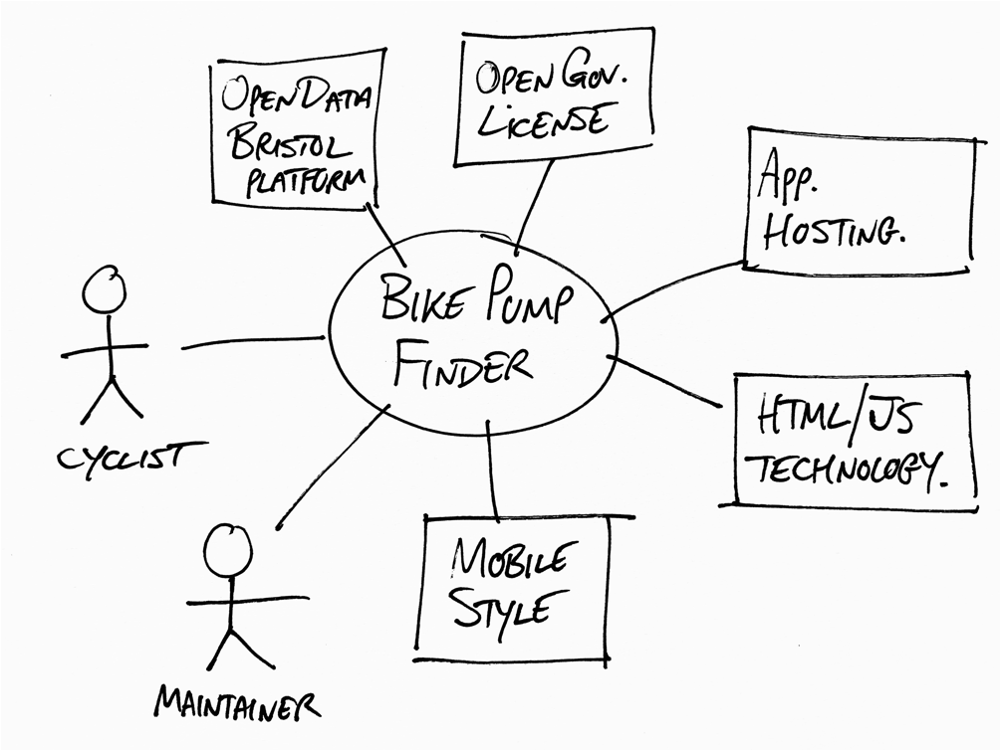

# Project Proposal

Data set: 

Planning permission Bristol  

### Why I have chosen this Dataset
The Bristol council publishes a planning application dataset they do this using the open Data Bristol They update this data set daily this is helpful as this will allow me to demon straight real information other than just displaying information that never changes this allows for a greater data set.   

### Problem statement
I am trying to solve the problem of making it much easier for people to identify and track the planning information that is available to them. Because of the amount of information that is available it can become hard to see the relevant information they can do this by entering into a search bar the information that is relevant to their project it is to help everyone to be able to access the direct information that is relevant to them and so they don’t get lost in a large amount of irrelevant data. 

### Business benefits
-easy to use  
-lots of usable data 
-easy to understand  
-lots of different ways to display the data 

### Options Considered
There is other options for people to use as an alternative I will focus on making mine easier to use and better than the competitors. 
Some of these options are Bristol City Council Planning Online portal, Plota, Plottr, PlanWatch and UK PlanIt.

### Expected Risks
Lots of competition other people who are making simlar app or other apps that exist  

## Project Scope
### What this app will be able to include 
### The user would be able to: 
  1. Search for planning applications 
  2. Filter by area/postcode 
  3. Filter by application type/status 
  4. Search by date 
  5. View application on a map 
  6. Click an application to see its details 
  7. There will be many statistics that will be available to them such as:
    a. Number of aplications by area 
    b. Applications approved/rejected 
    c. Applications over time 
    d. Most active areas of Bristol

