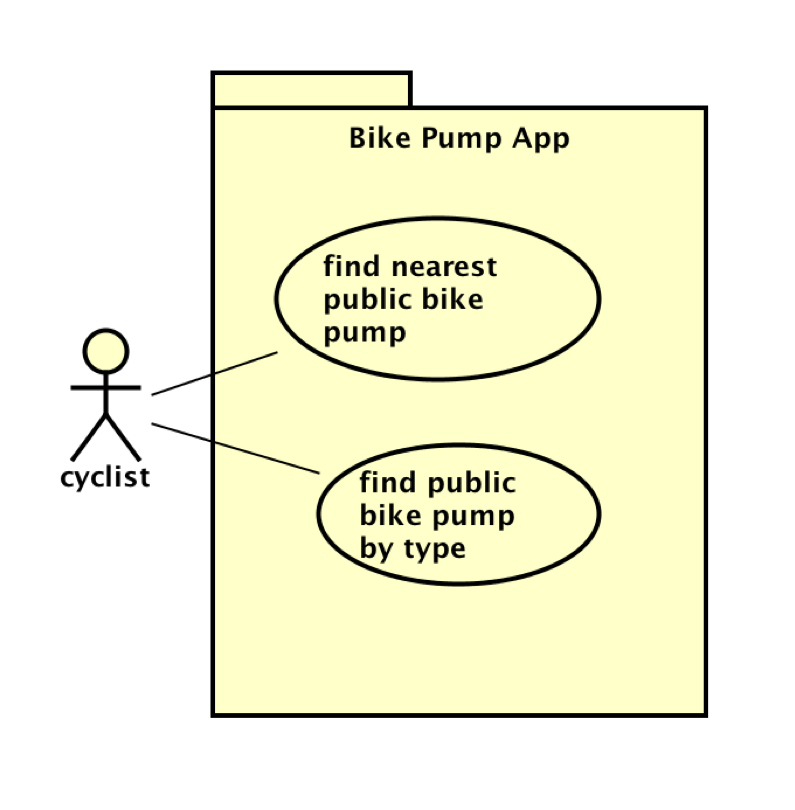

# Requirements

## User Needs

### User stories
A person who was using the system would first interact with it they would search planning information to see the results.
A person who would want to just see a list of all planing applications would just search planning applications this would benefit people who just want to see what planning applications are getting approved.
Another case would be a person who wanted to find by location on a map this would be a person who wants to see planning in a location that they may not know the post code or see what areas have the most planning applications easily.
A person who just wants to see the raw data of the planning applications would just view statistics 
A person who wants to view planning applications by post code would search using the filter post code or also by using address this would be a extra filter used this benefits people who want to see there planning permission and the status of it.

### Actors
The first actor would be the user as they are the person who is searching the webpage for information on planning permission this is the main person who will be using the page.

The other actor would be the council officer this would be the person who would mange the data and just it through Bristol open data that will automatically update the web page they may also use the web page to view statistics.

### Use Cases
TODO: Describe each use case (at least one per team member).
    Give each use case a unique ID, e.g. UC1, UC2, ...
    Summarise these using the use-case template below.

| TODO: USE-CASE ID e.g. UC1, UC2, ... | TODO: USE-CASE NAME | 
| -------------------------------------- | ------------------- |
| **Description** | TODO: Goal to be achieved by use case and sources for requirement |
| **Actors** | TODO: List of actors involved in use case |
| **Assumptions** | TODO: Pre/post-conditions if any</td></tr>
| **Steps** | TODO: Interactions between actors and system necessary to achieve goal |
| **Variations** | TODO: OPTIONAL - Any variations in the steps of a use case |
| **Non-functional** | TODO: OPTIONAL - List of non-functional requirements that the use case must meet. |
| **Issues** | TODO: OPTIONAL - List of issues that remain to be resolved |

Use-Case diagram

[](https://private-user-images.githubusercontent.com/344730781/684810338-5891d4f7-e090-49b2-944f-9209dd58fcc3.png?jwt=eyJ0eXAiOiJKV1QiLCJhbGciOiJIUzI1NiJ9.eyJpc3MiOiJnaXRodWIuY29tIiwiYXVkIjoicmF3LmdpdGh1YnVzZXJjb250ZW50LmNvbSIsImtleSI6ImtleTUiLCJleHAiOjE3OTQ4Mjc5MDgsIm5iZiI6MTc5NDgyNzYwOCwicGF0aCI6Ii8zNDQ3MzA3ODEvNjg0ODEwMzM4LTU4OTFkNGY3LWUwOTAtNDliMi05NDRmLTkyMDlkZDU4ZmNjMy5wbmc_WC1BbXotQWxnb3JpdGhtPUFXUzQtSE1BQy1TSEEyNTYmWC1BbXotQ3JlZGVudGlhbD1BS0lBVkNPRFlMU0E1M1BRSzRaQSUyRjIwMjYxMTE2JTJGdXMtZWFzdC0xJTJGczMlMkZhd3M0X3JlcXVlc3QmWC1BbXotRGF0ZT0yMDI2MTExNlQxMTEzMjhaJlgtQW16LUV4cGlyZXM9MzAwJlgtQW16LVNpZ25hdHVyZT1jYTYzOGM4MjIyZWNlYjg1MmVhOWQ5M2ZmOTIyNGFkMjg1MDA5MDJmMmNjMjRmZWY2OWMxZWZjNDdhNzMyMDQwJlgtQW16LVNpZ25lZEhlYWRlcnM9aG9zdCZyZXNwb25zZS1jb250ZW50LXR5cGU9aW1hZ2UlMkZwbmcifQ.2JRgIFNZdXrQ3eJNiunsclufW8GMVtXVp1XvFaKCDFQ)

## Software Requirements Specification
### Functional requirements
TODO: create a list of functional requirements. 
    e.g. "The system shall ..."
    Give each functional requirement a unique ID. e.g. FR1, FR2, ...
    Indicate which UC the requirement comes from.

### Non-Functional Requirements
TODO: Consider one or more [quality attributes](https://en.wikipedia.org/wiki/ISO/IEC_9126) to suggest a small number of non-functional requirements.
Give each non-functional requirement a unique ID. e.g. NFR1, NFR2, ...

Indicate which UC the requirement comes from.
